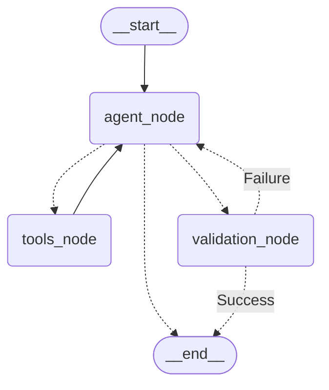

## Архитектура агента

Агентный цикл выполняется внутри контейнера [`Server`](/architecture/static/containers/server.md) как отдельный модуль на базе LangGraph.

> [!WARNING]
> Граф живёт один ход диалога

Когда агенту нужен ответ человека, он маршрутизируется в `__end__`, вопрос возвращается в UI, следующее сообщение пользователя запускает новый запуск графа с обновлённой историей.

### Цикл агента

> [!NOTE]
> В будущем актуальная диаграмма будет генерироваться с помощью LangGraph API

### State

State - типизированная схема состояния графа.

| Поле | Тип | Назначение |
| --- | --- | --- |
| `messages` | `list[BaseMessage]` | История чата |
| `dataset_id` | `str` | Ключ датасета в БД/File Storage |
| `dataset_profile` | `DatasetProfile` | Сжатый профиль из БД |
| `config_draft`  | `ConfigDraft \| None` | Черновик конфигурации |
| `iterations` | `int` | Счётчик шагов цикла |

### Узлы

| Узел | Компонент | Поведение |
| --- | --- | --- |
| `agent_node` | `LangGraph Engine` | Вызов LLM: системный промпт + история + профиль; инструменты привязаны через tool-calling |
| `tools_node` | `AutoML Tools` | Исполнение tool-call'ов; ошибка тула возвращается LLM как `ToolMessage` |
| `validation_node` | `Config Validator` | Pydantic-валидация `config_draft`; при ошибке — сообщение об ошибке в `messages` и возврат к `agent` |

### Инструменты агента

Инструменты (tools) - функции, через которые агент получает факты о данных и выполняет действия.

> [!TIP]
> [MVP] — минимальный набор для этапа 2 плана разработки.

#### Стадия 1 — Структура и качество данных

| Тул | Назначение |
|---|---|
| [MVP] `profile_dataset` | Схема: размеры, типы колонок, доля пропусков, константные колонки, дубликаты строк |
| `get_missingness_pattern` | Совместные пропуски (блоки, зависящие от условий), колонки с >50% пропусков |

#### Стадия 2 — Одномерные факты

| Тул | Назначение |
|---|---|
| [MVP] `get_column_statistics` | По одной колонке: квантили/среднее/перекос для числовых; кардинальность и топ-значения для категориальных |
| [MVP] `detect_outliers` | Выбросы по IQR/z-score: доли и экстремальные значения по колонке |
| `get_class_balance` | Распределение классов таргета, imbalance ratio (после подтверждения таргета) |

#### Стадия 3 — Связи и риски

| Тул | Назначение |
|---|---|
| `get_correlations` | Топ коррелирующих пар числовых признаков; корреляции признаков с таргетом |
| `check_leakage` | Утечки: пост-фактум признаки, прокси таргета, слишком предиктивные колонки |

#### Стадия 4 — Конфигурация

| Тул | Назначение |
|---|---|
| `get_capabilities` | Что умеет AutoGluon: доступные модели, метрики, ограничения для типа задачи |
| [MVP] `submit_config` | Передача финальной конфигурации в валидацию и очередь обучения |

> [!NOTE]
> Перечень тулов будет обновляться.

#### Правила проектирования инструментов

1. **Payload:** результаты - агрегаты и top-N списки, никаких сырых строк датасета
2. **Read-only:** все инструменты кроме `submit_config` не имеют побочных эффектов и идемпотентны
3. **Precomputed-first:** инструменты стадий 1–2 читают сохранённый профиль из БД; пересчёт по полному датасету внутри `tools_node` не допускается.

> [!NOTE]
> Контракты тулов фиксируются в коде через Pydantic-схемы.

### Контекст

Структура контекста, передающегося в LLM:

- История чата
- Профиль датасета (сжатый)
- Результаты вызова тулов

В будущем требуется реализация обрезки/суммаризации истории.

### Данные, уходящие в LLM

> [!CAUTION]
> При каждом вызове LLM содержимое промпта покидает границу системы и передаётся внешнему провайдеру.

Результаты тулов должны использовать агрегаты вместо сырых значений. В будущем возможна реализация санитизации имён колонок, которые могут содержать персональные данные.
