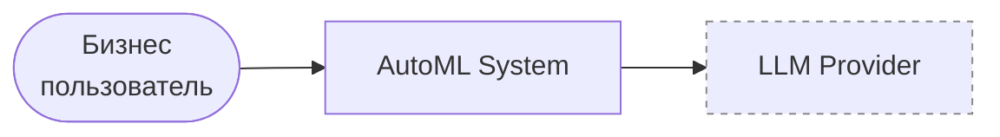

# Диаграмма контекста (C4 - L1)

- **Бизнес-пользователь** - единственный актор: загружает датасет, ведёт диалог,
  получает конфигурацию и результаты обучения.
- **LLM Provider** - внешняя система, «мозг» агента.
- **Граница доверия:** всё, что уходит в промпт, покидает контролируемую системой инфраструктуру.

