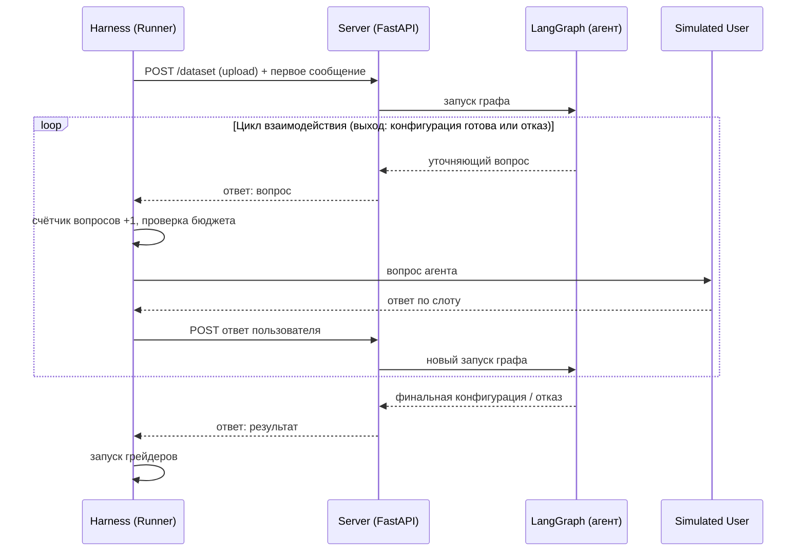
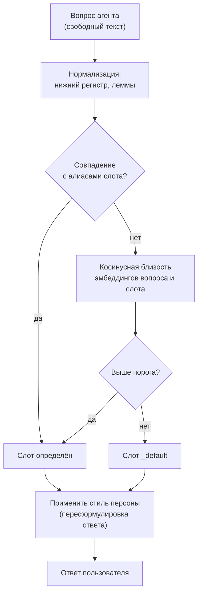
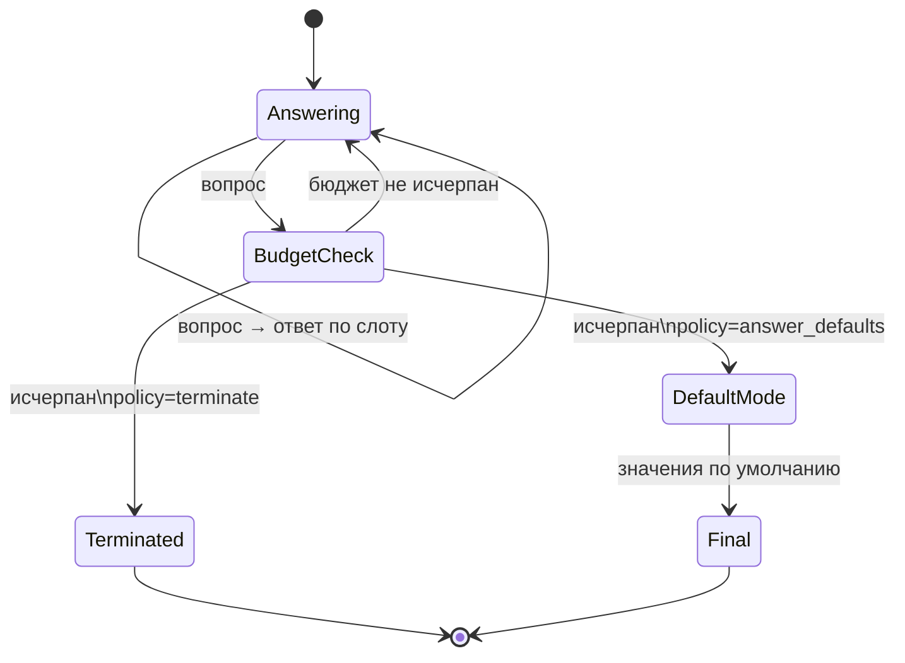

# Механика диалога

Документ отвечает на главный вопрос автоматизации: как тестировать агента, который задаёт вопросы пользователю.

## 1. Общая схема диалога

Граф агента живёт один ход диалога (см. [`/architecture/agent-architecture.md`](/architecture/agent-architecture.md)).
Для тестов это означает, что имитатор пользователя - просто ещё один «автор сообщений» в чате, и цикл «вопрос - ответ» не требует специальных механизмов в тестируемой системе.

## 2. Скриптовый слотовый имитатор

| Свойство | Следствие |
| --- | --- |
| Ключ по слоту, а не по тексту вопроса | Тесты устойчивы к перефразировке вопросов агентом и к правкам промптов |
| `_default` всегда доступен | Диалог не зависает; поведение «пользователь не знает» - само по себе тестируемый сценарий |
| Ответы фиксированы в базе знаний | Одинаковый вопрос получает одинаковый ответ во всех прогонах |

## 2.2. Бюджет вопросов - управляемая переменная

`question_policy` в манифесте делает число вопросов не только наблюдаемой метрикой, но и настройкой эксперимента:

| Параметр | Значения | Что проверяется |
| --- | --- | --- |
| `max_questions` | 0, 1…N | Способность работать без диалога / с жёстким лимитом |
| `on_budget_exhausted` | `answer_defaults` | Значение по умолчанию |
| | `terminate` | Корректное завершение |
| | `refuse` | Отказ |

### 2.3. Персоны

Файл `persona.yaml` описывает, как имитатор произносит канонические ответы. Персоны добавляют разнообразие стороны 1 внутрь диалога:

| Персона | Поведение | Что выявляет |
| --- | --- | --- |
| `expert_terse` | Отвечает одним словом («да», «y») | Умение агента работать с бедными ответами |
| `confused` | Иногда отвечает не на тот слот | Робастность к нерелевантным ответам |
| `impatient` | После 2 вопросов: «просто сделай как лучше» | Переключение на значения по умолчанию |
| `cooperative_default` | Всегда `_default` | Полная автономия агента |

Персона меняет только форму ответа, но не факты: канонические ответы берутся из `user_answers.yaml`.
