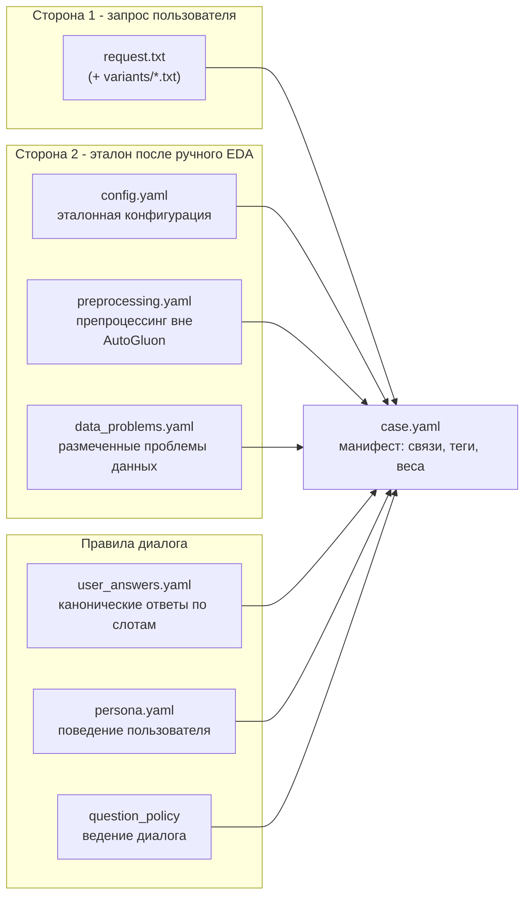

# База знаний тестовых сценариев

Документ описывает структуру базы знаний: из чего состоит один тестовый сценарий, как связаны его части и какие ограничения наложены на форматы.

> [!NOTE]
> База знаний - это данные, а не код. Она версионируется в репозитории, заполняется вручную на основе ручного EDA датасетов (см. [`/docs/Datasets/README.md`](/docs/Datasets/README.md)).

## 1. Расположение

```
agent_tests/
├── scenarios/                     # сценарии (данные)
│   ├── bank_marketing/
│   │   └── BM-01__precall-duration-leak/
│   │       ├── case.yaml              # манифест кейса
│   │       ├── request.txt            # запрос пользователя, дословно
│   │       ├── golden/                # эталоны
│   │       │   ├── config.yaml
│   │       │   ├── preprocessing.yaml
│   │       │   ├── data_problems.yaml
│   │       │   ├── user_answers.yaml
│   │       │   └── persona.yaml       # опционально
│   │       └── variants/              # переформулировки того же запроса
│   │           ├── terse.txt
│   │           └── cryptic.txt
│   ├── ...                           # остальные датасеты
│   └── shared/                      # кейсы без привязки к датасету
│       ├── OUT-01__clustering-unsupported/
│       └── CONF-01__contradictory-requirements/
├── taxonomy/                      # управляемые словари
│   ├── data_problems.yaml
│   ├── request_styles.yaml
│   ├── preprocessing_ops.yaml
│   └── metric_equivalence.yaml
├── harness/                       # код: runner, имитатор пользователя, грейдеры
└── reports/                       # артефакты прогонов
```

Идентификатор кейса строится как `<префикс датасета>-<номер>__<короткое имя>`: `BM-01`, `AQ-03`, `OUT-01` (out-of-scope), `CONF-01` (конфликт требований).

## 2. Состав сценария

Каждый сценарий связывает **две стороны** и правила диалога между ними:



### 2.1. `case.yaml` — манифест

```yaml
id: BM-01
dataset: bank_marketing/bank-full.csv
task_family: binary_classification

request:
  text_file: request.txt
  style_tags: [business_colloquial, metric_implied, moment_of_prediction_ambiguous]
  language: ru

question_policy:
  max_questions: 4
  on_budget_exhausted: answer_defaults # answer_defaults | terminate | refuse
  persona: persona.yaml # опционально

golden:
  config: golden/config.yaml
  preprocessing: golden/preprocessing.yaml
  data_problems: golden/data_problems.yaml

expected_dialogue:
  must_clarify: [target, moment_of_prediction] # слоты, которые нельзя угадать
  may_default: [metric, presets] # допустимые значения по умолчанию

scoring:
  weights: {config: 0.5, preprocessing: 0.2, problems: 0.2, dialogue: 0.1}
  hard_failures: [used_leaked_column]
```

Поля манифеста:

| Блок | Назначение |
| --- | --- |
| `request` | Сторона 1: текст запроса и теги стиля из таксономии |
| `question_policy` | Бюджет диалога и поведение при его исчерпании |
| `golden` | Сторона 2: ссылки на эталонные файлы |
| `expected_dialogue` | Какие слоты обязаны быть уточнены, а какие можно брать по умолчанию |
| `scoring` | Веса агрегированной оценки и «жёсткие» флаги |

### 2.2. `golden/config.yaml` — эталонная конфигурация

Файл повторяет схему из [`/docs/configuration.md`](/docs/configuration.md) и проверяется той же Pydantic-моделью, которую использует система.

> [!TIP]
> Эталон и результат агента описаны одной схемой, поэтому сравнение типобезопасно.

### 2.3. `golden/preprocessing.yaml` — подготовка данных

Только то, чего AutoGluon **не делает сам**:

```yaml
ops:
  - op: drop_columns # словарь preprocessing_ops.yaml
    columns: [duration]
    reason: leakage_post_factum
  - op: remap_sentinel
    column: pdays
    from: -1
    to: null_or_category_no_previous_contact
  - op: cast_categorical_codes
    columns: [] # пустой список — валидный эталон
```

> [!IMPORTANT]
> Сценарии с пустым эталоном обязательны: иначе метрика поощряет агента за обработку, которую AutoGluon выполняет и без него.

### 2.4. `golden/data_problems.yaml` — размеченные проблемы

Список проблем из таксономии [`taxonomies.md`](/docs/tests/taxonomies.md):

```yaml
problems:
  - id: class_imbalance
    severity: high
    expected_action: notice_and_pick_metric_other_than_accuracy
  - id: sentinel_codes
    columns: [pdays, poutcome, contact]
    severity: medium
  - id: leakage
    columns: [duration]
    severity: critical
    expected_action: warn_and_exclude_for_precall_scenario
```

### 2.5. `golden/user_answers.yaml` - канонические ответы

Ответы ключуются **слотом**, а не текстом вопроса - вопросы агента произвольны, а слот конечен. Слот `_default` гарантирует, что имитатор пользователя всегда может ответить, и диалог не заходит в тупик:

```yaml
slots:
  target:
    answer: "Столбец y — согласие открыть депозит"
    aliases: ["депозит", "откроет ли вклад"]
  moment_of_prediction:
    answer: "До первого звонка, о ходе разговора знать ничего нельзя"
  metric:
    answer: "Не пропустить желающих открыть депозит важнее"
  _default:
    answer: "Не знаю, выбери разумное значение по умолчанию"
```

### 2.6. `variants/` - переформулировки

Дополнительные файлы запроса для того же эталона. Один эталон + N формулировок позволяют отделить качество формулировки запроса от качества понимания данных: сравнение результатов по вариантам одного кейса изолирует эффект стиля.
