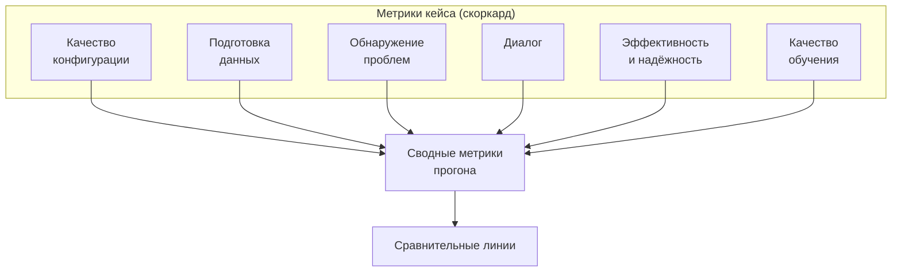

# Метрики

Документ описывает полный набор метрик: по одному кейсу (скоркард) и по прогону (сводные).

> [!IMPORTANT]
> **Каждая проверка - число**, агрегация и пороги - отдельные слои.

## 1. Структура метрик



## 2. Метрики кейса

### 2.1. Качество конфигурации

| Метрика | Тип |
| --- | --- |
| `config_score` | Взвешенная сумма полей, [0, 1] |
| `label_correct`, `problem_type_correct`, `eval_metric_correct` | Булевы по полям |
| `metric_credit` | Частичный кредит по классам эквивалентности |
| `ignored_columns_f1` | Set-F1 |
| `split_respected` | Флаг для временных/групповых кейсов |

### 2.2. Подготовка данных

| Метрика | Тип |
| --- | --- |
| `preprocessing_precision` / `recall` / `f1` | Доли по операциям |
| `over_engineering` | Число лишних операций (шум для эталона `none_needed`) |

### 2.3. Обнаружение проблем данных

| Метрика | Тип |
| --- | --- |
| `problem_recall` | Доля найденных из размеченных |
| `problem_precision` | Доля верных среди найденных |
| `problem_action_score` | Доля найденных, на которые последовало действие |

### 2.4. Диалог

| Метрика | Тип | Назначение |
| --- | --- | --- |
| `n_questions` | Число | Стоимость диалога для пользователя |
| `n_questions_vs_budget` | Отношение | Соблюдение `question_policy` |
| `n_questions_vs_must_clarify` | Отношение | Не спрашивает ли меньше необходимого |
| `question_relevance` | Доля | Спрашивает ли о действительно неоднозначном |
| `redundant_questions` | Число | Лишние вопросы при наличии дефолтов |
| `hallucinated_questions` | Число | Вопросы об уже сказанном |

### 2.5. Эффективность и надёжность

| Метрика | Тип |
| --- | --- |
| `llm_calls`, `llm_input_tokens`, `llm_output_tokens` | Счётчики |
| `llm_cost_usd` | Сумма по вызовам агента |
| `wall_time_dialogue_s`, `wall_time_total_s` | Время |
| `tool_calls`, `graph_iterations` | Активность агента |
| `outcome` | Перечисление жизненного цикла |
| `hard_failures` | Список флагов |

### 2.6. Качество обучения

| Метрика | Тип |
| --- | --- |
| `agent_metric` / `golden_metric` / `default_metric` | Значения на тестовой выборке |
| `quality_ratio_vs_golden` | [0, ∞), 1.0 - совпал с эталоном |
| `quality_ratio_vs_default` | Показатель ценности агента над дефолтами |

## 3. Скоркард кейса

```json
{
  "case_id": "BM-01",
  "outcome": "completed",
  "scores": {
    "config": 0.87,
    "preprocessing": {"precision": 1.0, "recall": 0.67, "f1": 0.8, "over_engineering": 1},
    "problems": {"recall": 1.0, "precision": 0.67, "action": 0.75},
    "dialogue": {"n_questions": 3, "vs_budget": 0.75, "relevance": 1.0, "redundant": 0, "hallucinated": 0},
    "quality": {"ratio_vs_golden": 0.98, "ratio_vs_default": 1.12}
  },
  "efficiency": {"llm_calls": 14, "llm_input_tokens": 18240, "llm_output_tokens": 4310,
                 "llm_cost_usd": 0.41, "wall_time_total_s": 812, "tool_calls": 22, "graph_iterations": 9},
  "hard_failures": [],
  "tags": {
    "problems": ["class_imbalance", "sentinel_codes", "leakage"],
    "styles": ["business_colloquial", "metric_implied"]
  },
  "artifacts": {"transcript": "reports/BM-01/transcript.json", "config": "reports/BM-01/config.json",
                "mlflow_run_id": "..."}
}
```

## 4. Сводные метрики прогона

### 4.1. Надёжность и правильность

| Метрика | Определение |
| --- | --- |
| `% launches without failures` | Доля кейсов с исходами `completed` + `refused_correctly` |
| `% correct label` / `% correct problem_type` / `% correct eval_metric` | Доли кейсов с точным попаданием в три самых значимых поля |
| `leakage_slip_rate` | Доля кейсов, где в итоговой конфигурации использована колонка с утечкой |
| `crash_rate` | Доля `crashed` + `config_invalid` |

### 4.2. Агрегаты индивидуальных метрик

| Метрика | Агрегаты |
| --- | --- |
| `config_score`, `problem_recall`, `problem_precision` | mean, p50, p95, min — **распределения, а не только средние** |
| `n_questions`, `llm_cost_usd`, `wall_time_total_s` | mean, p50, p95, сумма по набору |
| `cost_per_solved_case` | `Σ llm_cost / доля успешных кейсов` |
