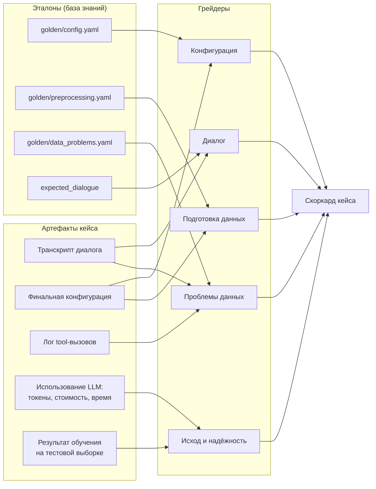
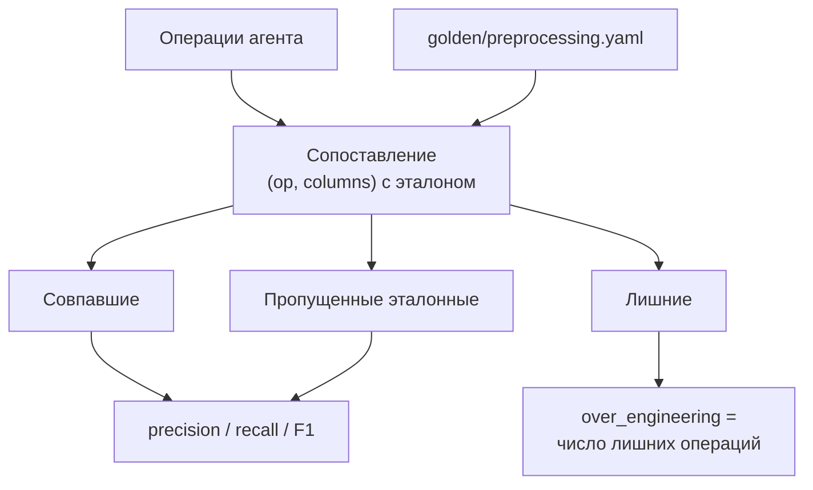

# Грейдеры

Документ описывает, как из результата кейса получаются метрики.

> [!NOTE]
> Грейдеры - детерминированные функции.

## 1. От артефактов к скоркарду

## 2. Грейдер конфигурации

Сравнение выполняется против `golden/config.yaml` **той же Pydantic-схемой**, что использует система.

| Поле | Механика | Кредит |
| --- | --- | --- |
| `label` | Точное совпадение с эталоном; 0, если выбрана колонка с утечкой или идентификатор | 1 / 0 |
| `problem_type` | Точное совпадение | 1 / 0 |
| `eval_metric` | Точное совпадение или класс эквивалентности из `taxonomy/metric_equivalence.yaml` | 1 / частичный / 0 |
| `positive_class` | Точное совпадение; «оба выбора защитимы» | 1 / 0.5 |
| `ignored_columns` | Найдена утчека/ID - кредит; исключение нужной колонки - штраф | [0, 1] |
| `validation_procedure`, стратегия разбиения | Совпадение + отдельный флаг `temporal_or_group_split_respected` для кейсов с временными/групповыми зависимостями | 1 / 0 |
| `time_limit` | Относительная ошибка; полный кредит в пределах ±10% | [0, 1] |
| `presets`, `num_bag_folds` и др. | Точное совпадение или «совместимое значение по умолчанию» | 1 / частичный |

Итог по кейсу: `config_score` = взвешенная сумма по полям с весами манифеста.

### Отказ как оцениваемый исход

Для кейсов `out_of_scope` и `conflicting_requirements` правильным результатом является **обоснованный отказ**:

- отказ с объяснением - исходный кредит по конфигурации = 1.0;
- молчаливое обучение неподдерживаемой задачи - 0.0 и флаг `unsupported_task_executed`.

## 3. Грейдер подготовки данных

Сопоставление предсказанных операций с `golden/preprocessing.yaml` по паре `(op, columns)` с допуском синонимов:

Метрики: `precision`, `recall`, `F1` и отдельный счётчик `over_engineering` - число операций, которых нет в эталоне.

> [!TIP]
> Сценарии с эталоном `none_needed` специально проверяют, что агент не «помогает» там, где AutoGluon справляется сам: для них `over_engineering > 0` - главный сигнал.

## 4. Грейдер проблем данных

| Метрика | Формула | Источник факта «найдено» |
| --- | --- | --- |
| `problem_recall` | найдено / размечено в эталоне | Упоминание в транскрипте, предупреждение, действие |
| `problem_precision` | найдено / (найдено + ложные срабатывания) | Эталонный список проблем |
| `problem_action_score` | доля найденных проблем, на которые агент отреагировал действием | Транскрипт + лог тулов, правила `expected_actions` из таксономии |

Распознавание «найдено» - правило-базированное: ключевые слова и факты действий.

## 5. Грейдер диалога

| Метрика | Механика |
| --- | --- |
| `n_questions` | Подсчёт ходов «вопрос пользователя» в транскрипте |
| `question_relevance` | Доля вопросов, попадающих в слоты `must_clarify` / неоднозначные по манифесту (слотовый мэтчинг) |
| `redundant_questions` | Вопросы о слотах, разрешённых как `may_default`, при наличии безопасного дефолта |
| `hallucinated_questions` | Вопросы о фактах, явно указанных в исходном запросе |

## 6. Грейдер исхода и качества обучения

| Метрика | Механика |
| --- | --- |
| `outcome` | Из жизненного цикла: `completed / refused_correctly / config_invalid / training_failed / crashed` |
| `quality_ratio` | Метрика агента на тестовой выборке / метрика эталонной конфигурации на том же разбиении; третья точка сравнения - AutoGluon с дефолтами |
| `hard_failures` | Флаги из манифеста: `used_leaked_column`, `unsupported_task_executed`, `leaked_test_data` - фиксируются как метрики и участвуют в сводных отчётах |

## 7. Свойства грейдеров

1. **Детерминизм.** Повторный прогон одного кейса с теми же действиями агента даёт идентичные метрики.
2. **Без вердиктов.** Грейдер не возвращает «прошёл/не прошёл» — только числа и флаги.
3. **Изолированность.** Каждый грейдер читает только свои артефакты и эталоны; падение одного грейдера не обнуляет остальные, а помечает метрику как `unavailable`.
4. **Проверяемость.** Для каждого грейдера существуют фикстуры: транскрипт-пример + эталон + ожидаемый скоркард (юнит-тесты грейдеров на Pytest).
