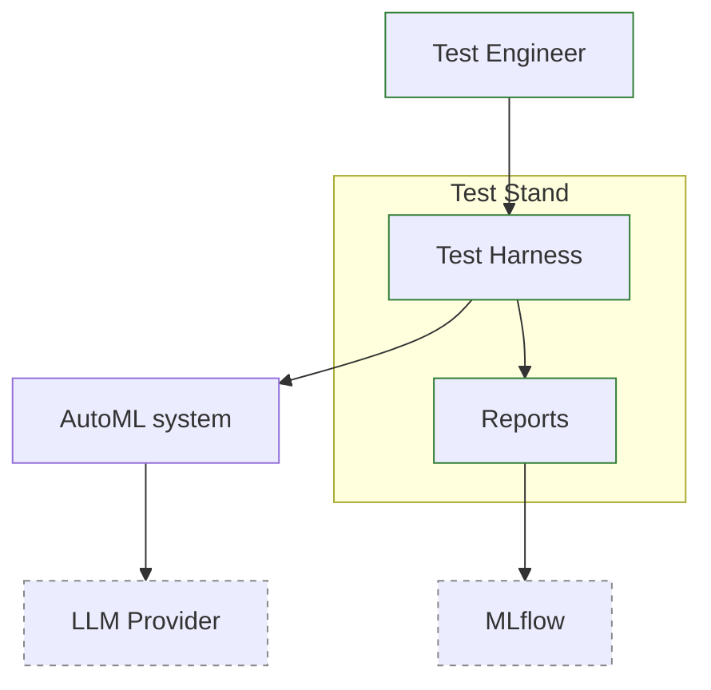
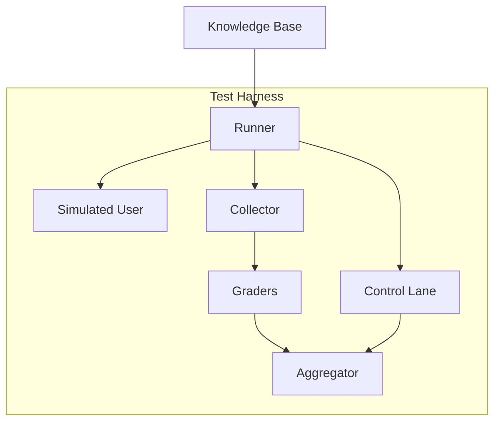

# Стенд тестирования

Документ описывает участников тестирования, их границы и окружение. Harness - это ещё один клиент системы, а не замена её частей.

## 1. Контекст стенда (C4, L1)

### Ключевые свойства

1. **Чёрный ящик.** Harness общается с системой через тот же HTTP API, что и веб-страница.
2. **Система не знает, что её тестируют.** Никаких тестовых режимов, заглушек или флагов в продакшен-коде.

## 2. Компоненты harness (C4, L2)

| Компонент | Ответственность |
| --- | --- |
| `Runner` | Читает манифест кейса, запускает цикл «сообщение - ответ/вопрос», применяет `question_policy` |
| `Simulated User` | Отвечает на вопросы агента по `user_answers.yaml`|
| `Collector` | Собирает информацию для грейдеров |
| `Graders` | Детерминированные функции для расчёта метрик |
| `Control Lane` | Обучение с эталонной конфигурацией и с дефолтами AutoGluon на идентичном разбиении - для `quality_ratio` |
| `Aggregator` | Сводит скоркарды в отчёт прогона, отправляет в MLflow |

## 3. Границы стенда

- Стенд не проверяет корректность AutoGluon как таковой - он проверяет, **правильно ли агент сконфигурировал** AutoGluon и подготовил данные.
- Стенд не заменяет юнит-тесты тулов и Pydantic-валидации - он работает поверх них.
- Предметные ошибки, которые нельзя обнаружить по данным (ошибка бизнес-семантики таргета), выявляются только эталонами, составленными человеком.
